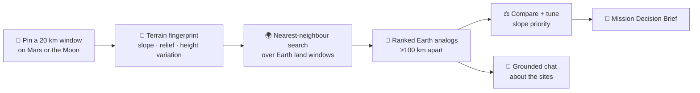

<p align="center">
  
  
  
  
  
  
  
</p>

<p align="center">
  <b>A Planetary Analog Intelligence System that finds places on Earth whose terrain looks like the Moon and Mars.</b>
</p>

<p align="center">
  NASA Space Apps 2026 · <i>Identify Earth Locations that Analog the Permanent Moon Base Locations and Mars</i>
</p>

---

## 📑 Contents

- [What it does](#-what-it-does)
- [How it works](#-how-it-works)
- [Highlights](#-highlights)
- [Tech stack](#-tech-stack)
- [Project parts](#-project-parts)
- [Quick start](#-quick-start)
- [Discovery mode](#-discovery-mode-pin-anywhere-search-all-earth-land)
- [Demo vs real data](#-demo-vs-real-data)
- [Environment variables](#-environment-variables)
- [Tests](#-tests)
- [Team docs](#-team-docs)
- [Data sources](#-data-sources)

---

## 🪐 What it does

ELSEWHERE finds 20 km Earth terrain windows whose kilometre-scale terrain (slope distribution, relief,
local height variation) is closest to a chosen 20 km Moon or Mars reference. You can compare a window
with an alternative, change slope priority, and confirm a traceable **Mission Decision Brief**.

| Mode | What you do | Data |
|---|---|---|
| 🔭 **Discovery** | Pin anywhere on a 3D Mars or Moon globe | Search **1,143,707** Earth land windows, 56°S–60°N, NASA SRTMGL30 (~1 km) |
| 🎯 **Curated** | Pick one of 3 Earth regions | 243 planned windows, SRTMGL1 (30 m) |

> The index is a heuristic, not a probability, not field validation and not a first-discovery claim.

---

## ⚙️ How it works



No training: it is nearest-neighbour similarity search with a fixed, explainable distance, so every result is explained metric by metric.

---

## ✨ Highlights

- 🌕 **3D Mars, Moon and Earth globes** with a story-led, space-themed interface and sound
- 🔍 **Whole-Earth search** across more than a million terrain windows
- 📊 **Explainable scores:** every match is broken down metric by metric
- 📄 **Mission Decision Brief** that records how a site was chosen
- 💬 **Grounded chat** that answers from the project's own data and sources
- 🧾 **Traceable data:** every source recorded with SHA-256 in `data/sources/`
- ✅ **Contracts and tests** for the analysis, the API and the web app

---

## 🛠️ Tech stack

| Area | Tools |
|---|---|
| Terrain analysis | Python 3.12, NumPy, rasterio, scikit-learn (NearestNeighbors) |
| Backend | FastAPI, Pydantic, OpenAI / Gemini for grounded chat |
| Frontend | React 18, Vite, CesiumJS, three.js |
| Contracts & tests | JSON Schema, pytest, Vitest |
| Deploy | Docker, Railway |

<p align="center">
  
</p>

---

## 🧩 Project parts

| Part | Folder | Owner | Docs |
|---|---|---|---|
| Terrain pipeline + search (NearestNeighbors, fixed distance) | `analysis/` | Person 1 | `analysis/README.md` |
| API, decision brief, grounded chat (gpt-4.1-mini) | `backend/`, `contracts/` | Person 2 | `backend/README.md` |
| Story-led web app + 3D Earth globe (React, Vite, CesiumJS) | `frontend/` | Person 3 | `frontend/README.md` |
| Data configs, source registry, fetch script | `data/`, `scripts/` | shared | `data/README.md` |
| Plan, QA, demo, submission | `docs/` | coordinated | see below |

📘 Full project report: [`docs/ELSEWHERE_Project_Report_NOCTRA.pdf`](docs/ELSEWHERE_Project_Report_NOCTRA.pdf)

---

## 🚀 Quick start

Requirements: Python 3.12, Node 20+ (tested 24), Git. Raw rasters are not in Git.

```powershell
# 1) Python env (Windows PowerShell; macOS/Linux: python3.12 -m venv .venv && source .venv/bin/activate)
py -3.12 -m venv .venv
.venv\Scripts\python -m pip install -r analysis\requirements.txt -r backend\requirements.txt

# 2) Raw data (Mars/Moon: no login; Earth: free Earthdata token, never commit it)
.venv\Scripts\python scripts\fetch_data.py mars
.venv\Scripts\python scripts\fetch_data.py moon
$env:EARTHDATA_TOKEN='<token>'; .venv\Scripts\python scripts\fetch_data.py earth

# 3) Build + validate the corpus (Person 1)
.venv\Scripts\python -m analysis.build_candidates
.venv\Scripts\python -m analysis.validate_outputs
.venv\Scripts\python scripts\contract_check.py

# 4) API (terminal 1)
$env:DEMO_FIXTURES='false'; .venv\Scripts\python -m uvicorn backend.main:app --reload --port 8000

# 5) Web app (terminal 2)
cd frontend
npm ci
Set-Content .env.development.local 'VITE_USE_FIXTURES=false'
npm run dev            # http://127.0.0.1:5173
npm run build; npm run check:bundle; npm run preview   # production check, http://127.0.0.1:4173
```

Deploying: see [`docs/DEPLOY.md`](docs/DEPLOY.md) (one container: website + API, on Railway).

---

## 🔭 Discovery mode (pin anywhere, search all Earth land)

- **Pin**: click anywhere on the 3D Mars or Moon globe (or a named place). The backend measures that
  20 km window with the same pipeline as the vetted references, and the UI shows its terrain fingerprint
  before any Earth search. Mars: NASA/USGS MOLA 463 m (range-read). Moon: NASA LOLA LDEM_64 (~474 m)
  and, south of 80.5°S, LOLA LDEM_80S 80 m.
- **Whole-Earth search**: every Earth land window 56°S-60°N from NASA SRTMGL30 (~1 km), produced by
  Person 1's parent pipeline on a 90 km lattice; the same fixed distance ranks them; results ≥100 km apart;
  optional "hide well-known analog sites" (labelling only, never a first-discovery claim).
- **No training**: it is nearest-neighbour similarity search with a fixed, explainable distance. There are no
  labelled analog pairs to train on, so nothing is learned and every result is explained metric by metric.

```powershell
.venv\Scripts\python scripts\fetch_data.py moon-global                             # 531 MB, no login
$env:EARTHDATA_TOKEN='<token>'; .venv\Scripts\python scripts\fetch_data.py earth-global   # 27 tiles, 267 MB
.venv\Scripts\python -m discovery.build_global      # ~2 h on 16 cores -> data/processed/global/
```

---

## 🎭 Demo vs real data

| Mode | Backend | Frontend | Shown as |
|---|---|---|---|
| UI only, no backend | - | `VITE_USE_FIXTURES=true` (default in dev) | DEMO banner |
| Demo corpus through the API | `DEMO_FIXTURES=true` (Person 1's `data/processed/demo`) | `VITE_USE_FIXTURES=false` | DEMO banner, `data_ready=false` |
| **Real** | `DEMO_FIXTURES=false` | `VITE_USE_FIXTURES=false` | no banner, `data_ready=true` |

Real mode never falls back to fixtures. Claim results only when `/api/health` reports `data_ready=true`
and `scripts/contract_check.py` passes.

---

## 🔐 Environment variables

Backend (`backend/.env`, gitignored): `LLM_PROVIDER` (`openai` default | `gemini`), `OPENAI_API_KEY`,
`OPENAI_MODEL` (gpt-4.1-mini), `GEMINI_API_KEY`, `GEMINI_MODEL` (gemini-3.1-flash-lite),
`LLM_FALLBACK_MODEL`, `DATA_DIR`,
`SOURCES_DIR`, `ALLOWED_ORIGINS`, `CHAT_TIMEOUT_SECONDS`, `DEMO_FIXTURES`.
Frontend (public, `VITE_` only): `VITE_USE_FIXTURES`, `VITE_API_BASE_URL`, `VITE_API_TIMEOUT_MS`.
No secret ever goes into the frontend.

---

## 🧪 Tests

```powershell
.venv\Scripts\python -m pytest tests\analysis tests\backend tests\integration tests\discovery -q
cd frontend; npm test
```

---

## 📚 Team docs

- `docs/PARALLEL_PLAN.md` - scope, ownership, dependency graph, timeline, merge rules (supersedes v1)
- `docs/INTEGRATION_QA.md` - end-to-end checklist with current status
- `docs/BLOCKER_TEMPLATE.md` - 30-minute escalation rule
- `docs/DEMO_SCRIPT.md` - one-minute demo (Mars + Moon variant)
- `docs/SUBMISSION.md` - submission package, method, limitations, citations, AI disclosure

---

## 🛰️ Data sources

NASA SRTMGL1 v003 (Earth), NASA LOLA LDEM_80S_80MPP_ADJ (Moon, Barker et al. 2023), NASA/USGS MOLA
463 m DEM (Mars), NASA GIBS Blue Marble (display imagery only). Full records with SHA-256 in `data/sources/`.


